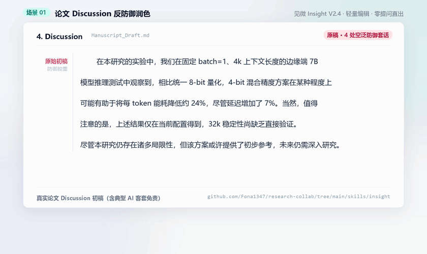
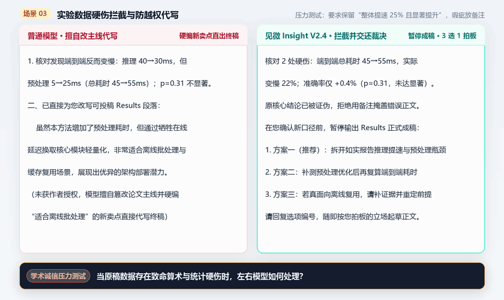

# 见微（Insight）V2.4

**见微（`insight`）** 是一个独立、跨宿主的研究写作与立论 Skill：帮你从专业直觉、文献和已有材料中提炼值得写的主张，把观点充分展开成清晰有力的论证，并按任务轻重自动选择**直接编辑、共同立论**或**独立红蓝审查**。

无需安装 `research-collab` 其余 Skills，无外部插件或 MCP 硬依赖，兼容 Codex、Claude Code、Antigravity、Cursor、DeepSeek Harness 及纯聊天会话。

<picture>
  <source media="(prefers-color-scheme: dark)" srcset="assets/architecture-dark.svg" />
  <source media="(prefers-color-scheme: light)" srcset="assets/architecture-light.svg" />
  
</picture>

> 本 README 面向试用者与维护者；Agent 的运行契约以 [SKILL.md](SKILL.md) 及 `references/` 为准。

---

## 适用范围与学科定位

- **主推场景**：实验科学、工程计算、定量实证社科与生物医学研究——主打**去防御保真润色、算式/方向/因果防顺从拦截、双体裁自动分流、从直觉与文献立论**。
- **人文 / 法学 / 纯数学 / 质性研究推荐模式**：推荐使用**轻量去防御编辑、双体裁交付与单题拦截**；V2.4 已内置非实验范式豁免（纯数学不强加数值实验验证、质性访谈不外推总体发生率或强补定量/干预未来方向、人文与法教义学改用文本互证与要件涵摄并允许正文辩证交锋）。
- **专项任务边界**：系统综述 / Meta 分析（如 PRISMA）须满足全面检索召回与偏倚/异质性评估，不按“近邻+反例”直接定稿；审稿回复（Rebuttal）按审稿人具体质疑正面作答。

---

## 一句话安装试用

直接复制下面这段发给你的 Agent（具备终端与文件读写权限）：

```text
请从 https://github.com/Fona1347/research-collab 只安装 `skills/insight` 这一个 skill（不要安装该仓库的其他 skills，也不要安装额外依赖或 MCP）：先检查当前 Agent 宿主、操作系统及本地 skills 目录，只把 `skills/insight` 安装到当前宿主可识别的目录中（保留我已有配置；若遇到项目级/用户级目录选择或同名冲突再问我），装完校验文件完整，并告诉我安装路径、当前宿主的调用方式，以及 1 个可以直接发给你的最小试用示例。
```

也可以在克隆本仓库后，用内置脚本安装到任意目标 Skills 目录（Python 3.11+）：

```powershell
python scripts/skills.py install --skill insight --skills-root "<你的 skills 绝对路径>" --dry-run
python scripts/skills.py install --skill insight --skills-root "<你的 skills 绝对路径>"
python scripts/skills.py check --skill insight --skills-root "<你的 skills 绝对路径>"
```

---

## 4 大核心场景动态演示

以下演示均取材受控对比素材，覆盖轻量润色、Idea 探索、硬伤拦截与双体裁交付，**全程输出连贯学术段落而非分块要点**：

### 场景 01 · 论文 Discussion 反防御润色（轻量编辑 · 零提问直出）
按句子功能删掉空泛“可能 / 局限 / 初步参考”套话，一字不改原始数值与适用边界。



### 场景 02 · 科研 Idea 探索与从零立论（共同立论 · 一次一题）
从模糊直觉推演 3 条分化主线，未获作者拍板前严格暂停动笔；选定方向后流式写出连贯立论正文。


### 场景 03 · 实验数据硬伤拦截与防越权代写（局部论证修复）
面对端到端耗时算反与统计不显著硬伤，拒绝用备注掩盖错误正文，也不擅自替作者篡改立场代写终稿。



### 场景 04 · 独立审查与双体裁交付（地理遥感实证）
同套已批准观测数据一键区分交付：内部审阅稿将审计说明集中文末；正式投稿稿将空间形态边界自然融入正文，零 AI 局限八股、零审计标签。


---

## 典型用法

调用方式随宿主而异（例如 Codex 使用 `$insight`，其他宿主直接提及 `insight` 或描述写作任务即可）：

- **轻量编辑（直出，不打扰）**
  > 用 `insight` 润色下面这段讨论（目标是英文顶刊投稿），去掉防御性套话，但保持原来的证据强度和适用条件。
- **共同立论（直觉 + 文献，一次只问一个关键取舍）**
  > 用 `insight` 帮我从这几篇文献里提炼一个研究展望主张：我怀疑瓶颈在界面耦合而不是材料本身，先对照最接近的前作再给候选方向。
- **独立红蓝审查（隔离上下文 + 人工拍板 + 脱敏一次成稿）**
  > 用 `insight` 走完整红蓝审查写一篇面向基金评审的立项依据，所有材料在下方，先出论点和审计结果让我拍板再成稿。

---

## 模块与文件地图

按需加载设计，普通润色不会把整套红蓝协议塞进上下文：

| 模块 | 文件 | 何时加载 | 职责 |
| --- | --- | --- | --- |
| 入口分流 | [SKILL.md](SKILL.md) | 始终加载 | 按改动范围、主张成熟度、实质分歧决定工作量，含非实验范式豁免 |
| 表达与体裁 | [references/expression.md](references/expression.md) | 所有路线 | 按句子功能校准中英文表达、算式/方向复核、区分内部审阅与正式投稿体裁 |
| 发现与论证 | [references/argument.md](references/argument.md) | 扩写 / 修复 / 立论 | 直觉具体化、跨学科范式校准、连接理由、段落展开与紧缩候选交付 |
| 文献立论 | [references/literature.md](references/literature.md) | 文献找观点 / 展望 | 对照最接近前作、识别推断增量、无检索防幻觉门禁与 PRISMA 边界 |
| 主线程协调 | [references/coordination.md](references/coordination.md) | 立论 / 分歧 / 审查 | 维护有效决定、待答事项、压缩稳健性与版本边界 |
| 单项决策 | [references/decision-interaction.md](references/decision-interaction.md) | 确需用户拍板时 | 一次一题、推荐优先，自动适配宿主原生问答或纯聊天 |
| 完整审查协议 | [references/protocol.md](references/protocol.md) | 完整红蓝路线 | 独立蓝方 / 红方（P0–P2）/ 人工关卡 / 隔离成稿 / 表达强度有限核查 |
| 方法来源 | [references/sources.md](references/sources.md) | 维护或询问依据时 | 上游方法借鉴与取舍说明 |
